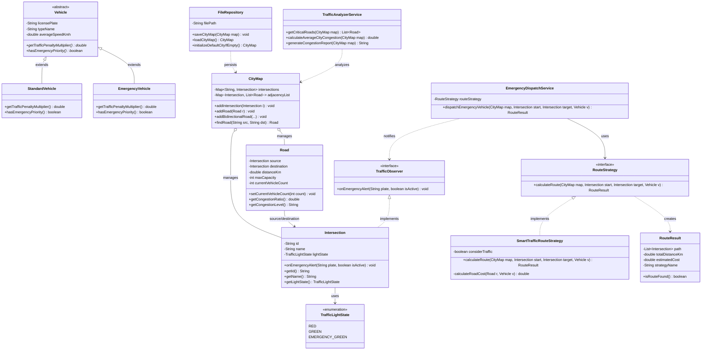

# 🚦 Akıllı Şehir Trafik Yönetimi ve Rota Optimizasyon Sistemi

Bu proje, **Nesneye Yönelik Programlama (OOP)** prensipleri, **SOLID** tasarım ilkeleri ve **Tasarım Kalıpları (Design Patterns)** kullanılarak geliştirilmiş bir şehir içi trafik yoğunluğu analiz, acil durum geçiş üstünlüğü (Yeşil Dalga) ve dinamik rota hesaplama simülasyonudur.

---

## 🎯 Temel Özellikler ve Mimari Yapı

* **Trafik Yoğunluğu Analizi:** Şehirdeki tüm yolların kapasite/araç oranlarını analiz eder, darboğaz (`%80+ KRİTİK`) oluşan güzergahları raporlar (`TrafficAnalyzerService`).
* **Dinamik Ağırlıklı Dijkstra Algoritması:** Sadece fiziksel mesafeyi (km) değil, anlık trafik yoğunluğunu ve aracın geçiş üstünlüğü katsayısını hesaba katarak en optimum rotayı bulur (`SmartTrafficRouteStrategy`).
* **Acil Durum Yeşil Dalga Sistemi:** Ambulans, İtfaiye ve Polis gibi acil durum araçları sevk edildiğinde güzergah üzerindeki kavşaklar otomatik olarak uyarılır ve trafik ışıkları `EMERGENCY_GREEN` moduna geçer (`EmergencyDispatchService`).
* **Kalıcı Veri Yönetimi (Persistence):** Eklenen tüm kavşaklar, yollar, trafik ışığı durumları ve anlık araç sayıları `data/traffic_data.txt` dosyasında kalıcı olarak saklanır (`FileRepository`).
* **Birim Testleri:** Sistemin tüm kritik işlevleri **JUnit 5** ile yazılmış **8 kapsamlı birim testi** (`TrafficSystemTest`) ile doğrulanmıştır.

---

## 🛠️ Uygulanan Mühendislik Prensipleri

### 1. Nesneye Yönelik Programlama (OOP)
* **Soyutlama (Abstraction):** `Vehicle` soyut sınıfı (`abstract class`) ile `RouteStrategy` ve `TrafficObserver` arayüzleri (`interface`).
* **Kalıtım (Inheritance):** `StandardVehicle` ve `EmergencyVehicle` sınıflarının `Vehicle` ata sınıfından türetilmesi.
* **Çok Biçimlilik (Polymorphism):** `getTrafficPenaltyMultiplier()` ve `hasEmergencyPriority()` metotlarının araç tipine göre çalışma zamanında farklı maliyet hesaplaması.
* **Kapsülleme (Encapsulation):** Sınıf değişkenlerinin `private` tutulması ve `Road` sınıfında kapasite aşımı/negatif değer doğrulamalarının yapılması.

### 2. SOLID Prensipleri
* **Single Responsibility (SRP):** Graf yönetimi (`CityMap`), trafik analizi (`TrafficAnalyzerService`), acil durum sevki (`EmergencyDispatchService`) ve dosya işlemleri (`FileRepository`) tamamen ayrı sınıflardadır.
* **Open/Closed (OCP):** Mevcut kodları değiştirmeden `RouteStrategy` arayüzü üzerinden yeni rota hesaplama algoritmaları sisteme eklenebilir.
* **Liskov Substitution (LSP):** `Vehicle` bekleyen tüm servis ve algoritmalar, `StandardVehicle` ve `EmergencyVehicle` alt sınıflarıyla tam uyumlu çalışır.
* **Interface Segregation (ISP):** Rota hesaplama (`RouteStrategy`) ve kavşak bildirim (`TrafficObserver`) sorumlulukları birbirinden bağımsız arayüzlere ayrılmıştır.
* **Dependency Inversion (DIP):** Üst seviye servisler (`EmergencyDispatchService`), somut algoritma sınıflarına değil soyut `RouteStrategy` arayüzüne bağımlıdır.

### 3. Tasarım Kalıpları (Design Patterns)
* **Strategy Pattern:** Rota hesaplama yönteminin (*Standart En Kısa Mesafe* vs. *Akıllı Trafik ve Öncelik Algoritması*) dinamik olarak değiştirilmesi.
* **Observer Pattern:** Acil durum aracı yola çıktığında güzergah üzerindeki kavşakların (`Intersection`) bildirim alarak ışıklarını yeşile çevirmesi.

---

## 📐 Matematiksel Maliyet Modeli (Dinamik Dijkstra)

Rota algoritmasında her bir yolun ağırlığı (maliyeti) aşağıdaki dinamik formülle hesaplanır:

$$\text{Yol Maliyeti} = \text{Mesafe (km)} \times \left(1 + \left(\frac{\text{Anlık Araç Sayısı}}{\text{Maksimum Kapasite}}\right)^2 \times 10 \times \text{Araç Ceza Katsayısı}\right)$$

* **Normal Araç (`StandardVehicle`):** Ceza katsayısı `2.5` olduğu için yoğun yollarda maliyet katlanarak artar ve araç alternatif açık rotalara yönlendirilir.
* **Acil Durum Aracı (`EmergencyVehicle`):** Ceza katsayısı `0.15` olduğu ve kavşaklarda yeşil dalga açıldığı için yoğunluktan minimum etkilenir, en hızlı ana arterden hedefe ulaşır.

---

## 📂 Proje Dizin Yapısı

```text
smart-city-traffic-management/
├── data/
│   └── traffic_data.txt                 # Kalıcı şehir haritası ve trafik verileri
├── src/
│   ├── main/java/tr/edu/traffic/
│   │   ├── model/                       # OOP varlık sınıfları, Enum ve Observer arayüzü
│   │   ├── repository/                  # Dosya okuma/yazma işlemleri (FileRepository)
│   │   ├── service/                     # Graf yönetimi, analiz ve acil durum servisleri
│   │   ├── strategy/                    # Dinamik Dijkstra algoritması (Strategy Pattern)
│   │   └── Main.java                    # İnteraktif konsol arayüzü (CLI)
│   └── test/java/tr/edu/traffic/
│       └── TrafficSystemTest.java       # 8 adet JUnit 5 birim testi
├── pom.xml                              # Maven proje ve bağımlılık yapılandırması
├── proje_takimi.txt                     # Proje ekibi ve görev dağılımı
└── README.md                            # Proje dokümantasyonu ve UML diyagramı
```

---

## 📊 UML Sınıf Diyagramı



---

## 🚀 Kurulum ve Çalıştırma

1. Depoyu bilgisayarınıza klonlayın:
   ```bash
   git clone [https://github.com/uzeyircavusoglu43-create/smart-city-traffic-management.git](https://github.com/uzeyircavusoglu43-create/smart-city-traffic-management.git)
   cd smart-city-traffic-management
   ```
2. Birim testlerini çalıştırın (JUnit 5):
   ```bash
   mvn test
   ```
3. Uygulamayı başlatmak için IDE üzerinden `tr.edu.traffic.Main` sınıfını çalıştırın veya konsoldan derleyin:
   ```bash
   mvn compile exec:java -Dexec.mainClass="tr.edu.traffic.Main"
   ```

---

## 👨‍💻 Geliştirici Ekibi (Contributors)

Bu proje ekip çalışması, katmanlı mimari ve versiyon kontrol süreçleri uygulanarak geliştirilmiştir:

| Geliştirici | Rol & Sorumluluk Alanı | GitHub Profili |
| :--- | :--- | :--- |
| **Üzeyir Çavuşoğlu** | Core OOP Mimarisi, Şehir Graf Yapısı (`CityMap`), Dinamik Dijkstra Algoritması (`Strategy Pattern`) & Acil Durum Yeşil Dalga Sistemi (`Observer Pattern`) | [@uzeyircavusoglu43-create](https://github.com/uzeyircavusoglu43-create) |
| **Arda Yılmaz** | Trafik Yoğunluk Analiz Servisi (`TrafficAnalyzerService`), Kalıcı Dosya Yönetimi (`FileRepository`), İnteraktif Konsol Arayüzü (`Main`), JUnit 5 Birim Testleri & Dokümantasyon | [@arda-ai28](https://github.com/arda-ai28) |
